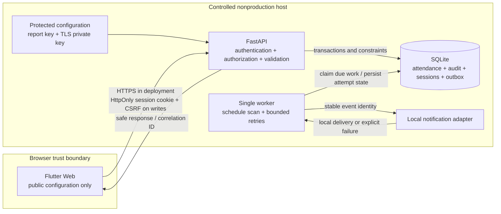

# Workflow boundary and data flow

Design baseline for the bounded student prototype. Runtime verification is recorded separately in the evidence index.

The system lets an authorized teacher save and finalize a class session's attendance, lets supervisors review operational evidence, and alerts responsible staff when sessions remain unsubmitted. The human decision is whether each student was Present, Late, Absent, or Excused; automation never infers an absence from an unavailable or unopened interface.

| Actor / component | Authority and ownership |
|---|---|
| Admin | Accounts, fictional student records, classes, assigned teachers, rosters, schedules; application administrator owns configuration and recovery |
| Teacher | Attendance for assigned classes; explicit finalization and reasoned corrections |
| Supervisor | Read-only operational review; receives escalation; owns follow-up decisions |
| Flutter Web | Untrusted presentation client; validates for usability, never grants authority or holds backend secrets |
| FastAPI | Trusted authorization, authoritative validation, transactions, safe responses, session checks |
| Worker | One documented instance; due-session scan and durable notification processing without browser dependency |
| SQLite | Persistent prototype state, constraints, audit, outbox, idempotency, replay protection |
| Local provider | Controlled local delivery only; no claim of external email or SMS |

Inputs are authenticated requests, controlled roster/schedule records, the trusted server clock, and protected configuration. Preconditions are an active authorized account, valid class ownership and roster membership, and valid session times. Outputs are persisted attendance, finalization/correction results, minimized reports, safe errors, and actionable alerts.

In scope: one complete browser workflow, authorization, controlled report exchange, local reminders, bounded recovery, academic tests and evidence. Non-goals: biometric verification, geolocation, automatic proof of physical presence, production identity federation, external email/SMS delivery, multi-region availability, mobile packaging, or production authorization.



No password, session token, CSRF value, report-encryption key, or TLS private key belongs in source, screenshots, committed logs, or the compiled client. Audit data is minimized; application diagnostics describe event category, safe identifiers, state, and correlation rather than request bodies.

```mermaid
sequenceDiagram
  actor Teacher
  participant UI as Flutter Web
  participant API as FastAPI
  participant DB as SQLite
  participant Worker
  Teacher->>UI: Select assigned session and mark roster
  UI->>API: Save with session, CSRF, version and idempotency key
  API->>API: Validate role, class ownership, roster and limits
  API->>DB: Atomic attendance update + audit + idempotency result
  DB-->>API: Commit
  API-->>UI: Confirm saved state and version
  Teacher->>UI: Review and finalize
  UI->>API: Explicit finalize request
  API->>DB: Validate all marked; finalize + audit
  Worker->>DB: Monitor due/unsubmitted sessions
  Worker->>DB: Deduplicated reminders / escalation
  Note over UI,Worker: Notification failure cannot undo saved attendance
```

Invalid input returns a safe validation outcome; missing/expired authentication requires login; a forbidden role or class is rejected; a stale update returns conflict; unavailable services return bounded feedback while unsaved entries remain visible. Finalized records require the dedicated correction path and reason. All failure paths require test evidence before being described as verified.
