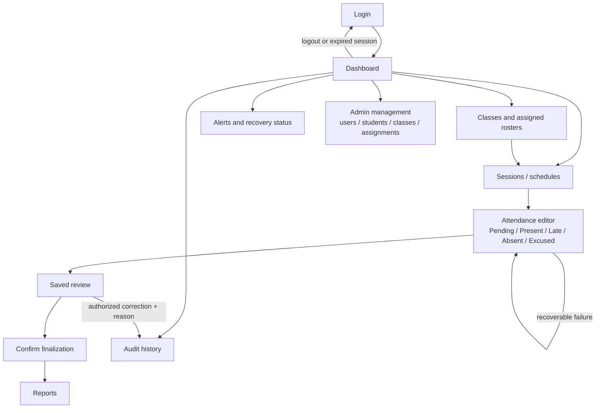

# Flutter Web screen flow

Design baseline. Test and browser artifacts must establish actual behavior at desktop, tablet, and narrow widths.

Admin sees management and authorized review. Teachers see assigned classes, relevant sessions, attendance, and their alerts. Supervisors see read-only summaries, reports, alerts, and permitted audit records. Missing navigation never substitutes for backend checks.

| State | Required user feedback | Recovery |
|---|---|---|
| Loading | Busy indicator with meaningful label | Prevent repeated consequential action |
| Empty | Explain no assigned classes/sessions/records | Offer role-appropriate next action |
| Validation | Field label and concrete correction | Retain entered values |
| Saved | Explicit confirmed backend save | Review before finalizing |
| Unsaved | Visible unsaved-change indication | Retain pending entries on recoverable errors |
| Unauthenticated | Session unavailable/expired | Return to login; no hidden privileged content |
| Forbidden | Safe access-denied feedback | Return to an authorized screen |
| Conflict | Data changed since load | Refresh/reconcile; do not silently overwrite |
| Network/server | Safe service-unavailable feedback | Retry with idempotency and retained entries |

Use labels in addition to color. Keep meaningful keyboard focus after dialogs, expose progress/status semantics, and avoid clipped tables by scrolling or switching to narrow layouts. Verify the principal journey and adverse recovery at common browser widths.
